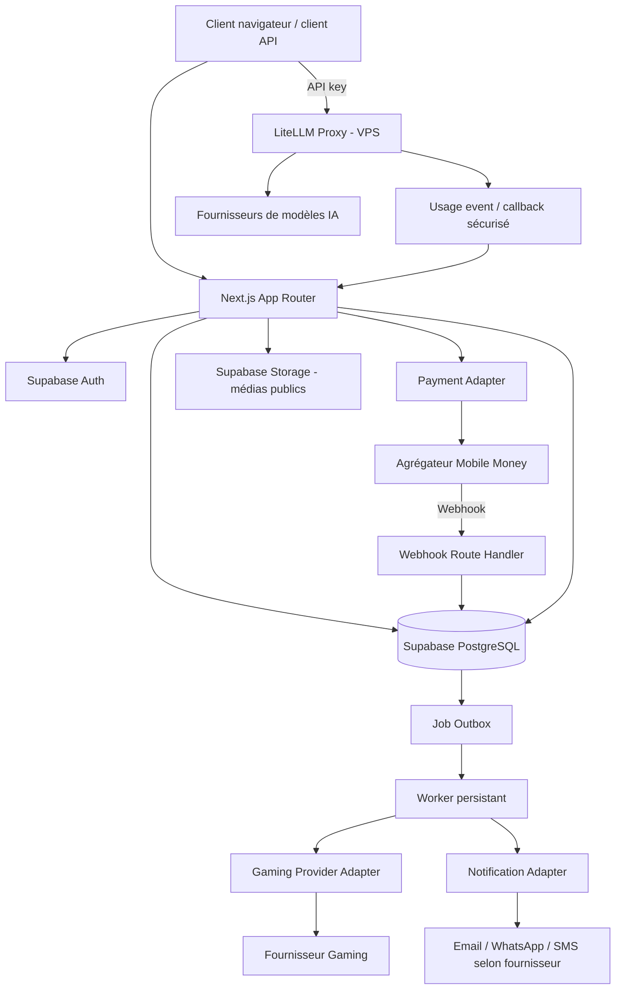
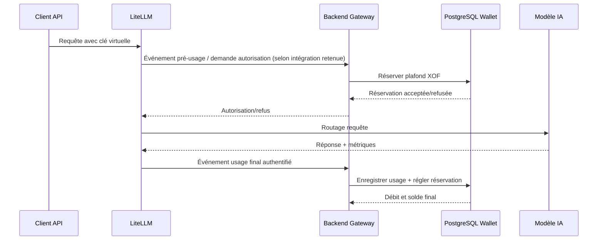
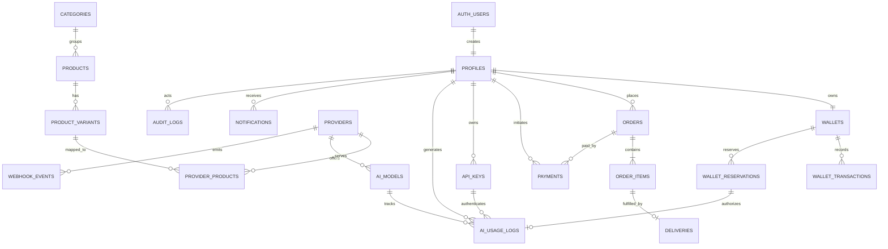
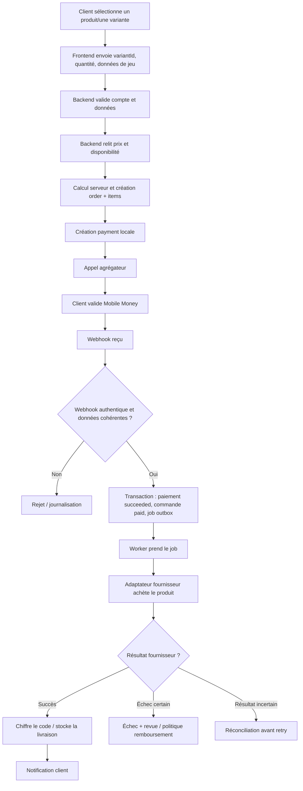

# STRUCTURE GLOBALE DE LA PLATEFORME — GAMING STORE & AI CREDITS

> **Document de référence technique pour le développement assisté par IA (Claude Code, Cursor, Codex ou équivalent).**
>
> | Métadonnée | Valeur |
> |---|---|
> | Version du document | 1.0 — structure globale détaillée |
> | Date | 10 novembre 2026 |
> | Marché initial | Togo — extension Afrique de l’Ouest à confirmer |
> | Devise de vente | XOF (FCFA) |
> | Langue de l’interface initiale | Français |
> | Architecture | Monolithe modulaire Next.js + services spécialisés |
> | Frontend / BFF | Next.js App Router + TypeScript |
> | Données / Authentification | Supabase Auth + PostgreSQL + RLS |
> | Passerelle IA | LiteLLM Proxy sur infrastructure séparée |
> | Traitements asynchrones | Worker(s) consommant une outbox persistante PostgreSQL |
> | État | Baseline de conception ; intégrations externes et migration à valider avant production |

---

## 0. Comment utiliser ce document

Ce fichier décrit la structure cible de la plateforme, les responsabilités de chaque partie du code, les données, les interfaces entre modules et les flux métier. Il doit servir de source de référence au développeur et aux agents IA.

### 0.1 Légende de provenance

- **[BASELINE]** : élément explicitement prévu dans le plan initial ou le cahier des charges technique V1.0.
- **[RECOMMANDATION]** : précision d’architecture proposée pour rendre le produit maintenable, testable et sûr.
- **[À DÉCIDER]** : choix qui n’est pas encore confirmé.
- **[À VALIDER FOURNISSEUR]** : capacité ou condition qui dépend d’un opérateur, d’un agrégateur, d’un distributeur ou d’un fournisseur IA.

Ne jamais transformer une recommandation ou une hypothèse en intégration réelle sans preuve issue de la documentation et d’un test fournisseur.

### 0.2 Documents liés

Ce document complète les livrables précédemment préparés :

- `cahier_des_charges_technique_gaming_ai_v1.docx` : exigences fonctionnelles et non fonctionnelles.
- `supabase_schema_v1.sql` : migration initiale PostgreSQL/Supabase.
- `Plan MVP SaaS de cartes cadeaux gaming et tokens IA.pdf` : plan produit source.

Le présent fichier décrit l’organisation globale du dépôt et le comportement attendu. Il ne remplace pas les migrations SQL, les contrats d’API fournisseurs ni les documents légaux.

### 0.3 Règle de cohérence

En cas de divergence :

1. une règle de sécurité ou une contrainte de base de données prime sur une facilité d’interface ;
2. le cahier des charges décrit les comportements fonctionnels ;
3. la migration SQL décrit la structure de données actuellement proposée ;
4. toute évolution de structure doit passer par une nouvelle migration versionnée et une mise à jour de ce document.

---

# 1. Vision et définition du produit

## 1.1 Concept

La plateforme est un commerce numérique unique composé de deux lignes commerciales :

1. **Gaming Store** : vente de cartes cadeaux, de codes numériques et de monnaies/crédits de jeux vidéo.
2. **AI Credits** : vente d’un accès prépayé à des modèles d’intelligence artificielle par clés API individuelles, avec mesure et facturation de la consommation.

Les clients utilisent un compte unique. Les deux lignes commerciales partagent les services transverses : authentification, paiements, portefeuille, notifications, commandes lorsque cela s’applique, support, administration et reporting.

## 1.2 Objectifs métier

| Objectif | Résultat attendu |
|---|---|
| Commercialiser des produits gaming | Une commande payée est livrée une seule fois ou passe en revue manuelle avec une trace exploitable. |
| Accepter les paiements locaux | Le paiement est confirmé côté serveur par notification vérifiée ou vérification serveur-à-serveur. |
| Protéger les crédits prépayés | Chaque crédit, débit ou correction est journalisé ; aucune double dépense n’est possible. |
| Fournir des accès IA | Une clé API par client, des limites de modèles et de consommation, un historique détaillé et une facturation XOF. |
| Gérer l’activité | L’équipe peut administrer les produits, prix, fournisseurs, transactions, commandes, incidents, coûts et marges. |

## 1.3 Principes non négociables

1. Une seule application métier, organisée en modules séparés.
2. Toute opération financière est exécutée côté serveur.
3. Le navigateur n’est jamais la source de vérité d’un prix, d’un paiement, d’un solde, d’une livraison ou d’un rôle.
4. Les prix et montants commerciaux en XOF sont des entiers (`BIGINT`/`number` entier validé) ; aucun `float` pour l’argent.
5. Les coûts fournisseurs en USD/EUR et les prix par token utilisent `NUMERIC`/décimaux contrôlés.
6. Les paiements, webhooks, crédits de wallet, réservations et livraisons sont idempotents.
7. Les appels externes sont isolés derrière des adaptateurs remplaçables.
8. Les opérations pouvant dépasser la durée d’une requête HTTP sont exécutées par un worker persistant.
9. Les secrets ne sont jamais placés dans le frontend, dans des tables publiques, dans les logs ou dans le dépôt Git.
10. Une opération dont le résultat externe est incertain doit être réconciliée avant une nouvelle tentative qui pourrait entraîner un double achat ou un double débit.

## 1.4 Terminologie

| Terme | Signification |
|---|---|
| Produit | Article commercial publié dans le catalogue gaming. |
| Variante | Dénomination ou option achetable d’un produit (ex. valeur, région, serveur). |
| SKU interne | Identifiant stable de la variante dans la plateforme. |
| Fournisseur | Service externe qui fournit le code, le top-up ou le service numérique. |
| Agrégateur | Prestataire qui collecte le paiement Mobile Money et transmet un événement de confirmation. |
| Commande | Intention d’achat du client, contenant une ou plusieurs lignes. |
| Paiement | Tentative de collecte associée à une commande ou une recharge. |
| Livraison | Résultat de l’approvisionnement numérique d’une ligne de commande. |
| Wallet | Solde prépayé de l’utilisateur, libellé en XOF. |
| Ledger | Journal append-only des opérations financières du wallet. |
| Réservation | Somme bloquée temporairement avant de connaître le coût final d’une requête IA. |
| AI Gateway | Point d’entrée API qui authentifie la clé client, contrôle les limites et route la requête IA. |
| Outbox | Table persistante qui conserve les tâches à exécuter par des workers. |
| Idempotence | Garantie qu’une même opération logique répétée ne produit pas deux effets métier. |

---

# 2. Périmètre fonctionnel

## 2.1 Inclus dans le produit cible

### A. Store Gaming

- Page d’accueil et navigation.
- Catégories et sous-catégories.
- Catalogue de produits gaming.
- Fiches produits et informations de région/plateforme.
- Variantes et prix XOF.
- Saisie des données nécessaires au top-up lorsqu’un jeu l’exige (ex. identifiant joueur, serveur, région).
- Panier ou récapitulatif d’achat.
- Création de commande côté serveur.
- Paiement Mobile Money.
- Historique des commandes.
- Livraison numérique sécurisée.
- Gestion des commandes en anomalie.

### B. Paiements

- Choix d’une méthode disponible : Flooz et Mixx selon les méthodes réellement activées par l’agrégateur.
- Création de transaction.
- Référence marchande unique.
- Page de retour/statut.
- Réception et authentification des webhooks.
- Comparaison du montant, de la devise, de la référence et du statut.
- Réconciliation périodique des paiements en attente.
- Remboursement lorsque le prestataire et la politique commerciale le permettent.

> **Nomenclature :** l’interface doit afficher le nom commercial courant validé avec le prestataire. Le code interne historique `tmoney` reste une valeur technique du schéma V1 ; il ne doit pas être utilisé comme libellé public définitif sans validation.

### C. Fournisseurs gaming

- Connexion à un ou plusieurs distributeurs autorisés.
- Référencement des produits externes.
- Mapping `product_variant` vers `provider_product`.
- Récupération ou mise à jour des coûts fournisseur.
- Achat à la demande.
- Récupération de code ou confirmation de top-up.
- Réconciliation du statut d’achat fournisseur.
- Livraison automatique ou transfert en revue manuelle.

### D. Compte client

- Inscription et connexion par téléphone/OTP ; email facultatif selon décision produit.
- Profil.
- Commandes et détail des commandes.
- Historique des paiements.
- Portefeuille XOF.
- Historique de crédits/débits.
- Clés API IA.
- Consommation et coûts affichés au client.
- Notifications.

### E. Wallet

- Création automatique d’un wallet XOF à la création du profil.
- Recharge depuis un paiement confirmé.
- Calcul du disponible : `balance_xof - reserved_xof`.
- Journal immuable des transactions.
- Réservation de fonds avant requête IA.
- Règlement sur coût réel.
- Libération des fonds non utilisés.
- Remboursements et ajustements audités.

### F. AI Credits

- Catalogue des modèles autorisés.
- Tarification et version de prix.
- Clés virtuelles individuelles.
- Restrictions de modèles.
- Budgets et limites RPM/TPM si disponibles dans LiteLLM.
- Routage par LiteLLM.
- Comptabilisation des tokens d’entrée/sortie/cache.
- Conversion du coût fournisseur en XOF.
- Marge commerciale configurable.
- Préautorisation du montant estimé.
- Règlement et historique de consommation.
- Révocation et suspension des clés.

### G. Administration et support

- Gestion des profils et rôles.
- Gestion des catégories, produits et variantes.
- Gestion des prix, régions et disponibilités.
- Gestion des fournisseurs et mappings.
- Consultation des commandes, paiements et livraisons.
- Consultation des webhooks et tâches en échec.
- Remboursements et ajustements avec motif obligatoire.
- Gestion des modèles IA, tarifs et marges.
- Gestion des clés et quotas côté plateforme.
- Reporting financier.
- Notifications et notes internes de support.
- Journal d’audit.

## 2.2 Hors périmètre initial

- Applications mobiles natives iOS et Android : le MVP est un site responsive.
- Marketplace multi-vendeurs avec comptes marchands séparés.
- Transferts de wallet entre utilisateurs.
- Rémunération d’un solde ou intérêts.
- Gestion logistique de produits physiques.
- Partage des comptes fournisseur ou des clés maîtres IA.
- Accès IA gratuit illimité.
- Publication de produits dont le fournisseur, le pays, la région ou le droit de revente n’ont pas été vérifiés.

## 2.3 Principes de lancement MVP

Le lancement commercial initial doit être limité à un produit gaming dont le flux complet est validé :

1. produit publié ;
2. commande créée ;
3. paiement sandbox puis paiement réel confirmé côté serveur ;
4. webhook vérifié ;
5. achat fournisseur ;
6. livraison ;
7. historique client ;
8. procédure de secours manuelle.

Le wallet prépayé et AI Credits viennent après la fiabilisation du flux gaming.

---

# 3. Acteurs, rôles et permissions

## 3.1 Rôles

| Rôle | Actions autorisées | Restrictions |
|---|---|---|
| Visiteur (`anon`) | Lire les catégories, produits, variantes et modèles explicitement publiés. | Aucune donnée privée ou transactionnelle. |
| Client (`customer`) | Gérer son profil, créer des commandes, payer, voir ses commandes/livraisons, recharger son wallet, gérer ses clés et consulter son usage. | Ne peut pas créditer/débiter un wallet, modifier les statuts de paiement, lire les données d’un autre client ou choisir son propre rôle. |
| Support (`support`) | Consulter les données nécessaires au support, suivre les incidents, créer des notes internes selon les permissions. | Pas de gestion des rôles, des prix, des secrets, des écritures du ledger ou des remboursements non autorisés. |
| Administrateur (`admin`) | Gérer catalogue, prix, fournisseurs, commandes, remboursements, utilisateurs, paramètres IA, marges et reporting. | Toute action sensible doit être autorisée côté serveur, justifiée et auditée. |

## 3.2 Source de vérité du rôle

- Le rôle est stocké dans `public.profiles.role`.
- Il ne doit jamais être pris depuis les métadonnées éditables par le client dans Supabase Auth.
- L’attribution d’un rôle support/admin se fait par une opération serveur réservée à un administrateur autorisé.
- Chaque route `/api/admin/*` revérifie le rôle côté serveur.
- La clé `service_role` contourne RLS : son utilisation n’annule pas les vérifications métier et de rôle.

## 3.3 Matrice simplifiée des ressources

| Ressource | Visiteur | Client propriétaire | Support | Admin |
|---|---|---|---|---|
| Catalogue publié | Lecture | Lecture | Lecture | CRUD |
| Profil | — | Lecture / champs autorisés | Lecture limitée | Gestion contrôlée |
| Commandes | — | Lecture des siennes | Lecture support | Gestion |
| Paiements | — | Lecture des siens | Lecture support | Gestion / réconciliation |
| Wallet | — | Lecture du sien | Lecture limitée si nécessaire | Opérations serveur auditées |
| Ledger | — | Lecture du sien | Lecture limitée | Lecture / contre-écritures contrôlées |
| Codes livrés | — | Lecture si commande propriétaire et livrée | Accès support contrôlé | Accès exceptionnel audité |
| Clés API | — | Gestion des siennes | Métadonnées seulement | Gestion/révocation, jamais secret maître |
| Usage IA | — | Lecture du sien | Lecture support limitée | Reporting |
| Fournisseurs | — | — | Lecture limitée si nécessaire | Gestion sans afficher les secrets |
| Logs d’audit | — | — | Selon politique | Lecture |

---

# 4. Architecture générale du système

## 4.1 Vue d’ensemble



## 4.2 Responsabilité de chaque composant

| Composant | Responsabilité | Ne doit pas faire |
|---|---|---|
| Next.js | UI, sessions côté serveur, API BFF, validation et orchestration des cas d’usage. | Stocker des secrets dans le navigateur ou décider seul qu’un paiement est réussi. |
| Supabase Auth | Identité, session, OTP et JWT. | Porter la responsabilité métier du rôle admin via metadata utilisateur. |
| PostgreSQL | Données relationnelles, contraintes, transactions atomiques, RLS et journal financier. | Exposer directement des RPC sensibles au client. |
| Supabase Storage | Images et médias publics du catalogue. | Stocker des codes cadeaux, PIN, clé API brute ou secret fournisseur. |
| Payment Adapter | Traduire le contrat interne en appels agrégateur. | Marquer une commande payée sur la base d’une redirection client. |
| Gaming Provider Adapter | Traduire le contrat interne en API fournisseur. | Relancer à l’aveugle un achat dont le résultat est incertain. |
| LiteLLM | Authentifier les clés virtuelles, router les modèles et fournir les mesures de coût/usage. | Gérer seul la comptabilité XOF et le ledger de la plateforme. |
| Worker | Traiter les tâches persistantes : livraison, notification, réconciliation et expiration. | Exécuter des tâches sans idempotence ou sans journaliser les erreurs. |
| Monitoring | Mesures, logs, alertes et corrélation des incidents. | Enregistrer les secrets ou contenus sensibles. |

## 4.3 Style d’architecture

**Monolithe modulaire** pour l’application métier : un seul dépôt Next.js, mais des domaines isolés et des interfaces internes explicites.

Services spécialisés séparés :

- Supabase pour Auth/PostgreSQL/Storage ;
- LiteLLM sur VPS ou service compute dédié ;
- worker persistant pouvant être déployé séparément du frontend ;
- prestataires tiers connectés par adaptateurs.

Ne pas introduire des microservices indépendants pour chaque domaine au MVP. La séparation par modules suffit, tout en laissant la possibilité d’extraire un service plus tard.

## 4.4 Communication synchrone et asynchrone

- Lecture catalogue : requête HTTP/SQL.
- Création commande : cas d’usage serveur + transaction SQL.
- Création paiement : enregistrement local, puis appel à l’agrégateur.
- Confirmation paiement : webhook entrant, vérification, transaction et insertion outbox.
- Achat fournisseur : worker asynchrone.
- Notifications : worker asynchrone.
- Appel IA : passage par LiteLLM, préautorisation wallet, collecte d’usage, règlement wallet.
- Réconciliation : job planifié ; vérification des paiements et livraisons ambigus.

---

# 5. Structure du dépôt de code

## 5.1 Arborescence cible

```text
platform-gaming-ai/
│
├── .github/
│   └── workflows/
│       ├── ci.yml                         # lint, typecheck, tests et build
│       ├── migration-check.yml            # vérification des migrations
│       └── security-check.yml              # audit dépendances / secrets
│
├── docs/
│   ├── STRUCTURE_GLOBALE_PLATEFORME.md     # présent document
│   ├── PROJECT_OVERVIEW.md                 # résumé du produit
│   ├── PRODUCT_SPECIFICATION.md            # exigences fonctionnelles
│   ├── TECHNICAL_ARCHITECTURE.md            # architecture détaillée
│   ├── DATABASE_SCHEMA.md                   # dictionnaire des données
│   ├── API_CONTRACTS.md                     # routes, payloads et erreurs
│   ├── SECURITY_RULES.md                    # règles sécurité obligatoires
│   ├── PAYMENT_RUNBOOK.md                   # traitement incidents paiement
│   ├── DELIVERY_RUNBOOK.md                  # traitement incidents livraison
│   ├── AI_BILLING_RUNBOOK.md                # facturation et rapprochement IA
│   ├── DEPLOYMENT.md                        # déploiement et rollback
│   ├── DECISIONS.md                         # décisions d’architecture (ADR)
│   └── PROGRESS.md                          # avancement courant du développement
│
├── public/
│   ├── images/
│   ├── icons/
│   └── fonts/                              # uniquement polices dont la licence est valide
│
├── src/
│   ├── app/
│   │   ├── (store)/
│   │   │   ├── page.tsx                    # accueil public
│   │   │   ├── gaming/page.tsx             # catalogue gaming
│   │   │   ├── categories/[slug]/page.tsx  # catégorie
│   │   │   ├── products/[slug]/page.tsx    # fiche produit
│   │   │   ├── checkout/page.tsx           # récapitulatif et choix paiement
│   │   │   ├── order/[orderNumber]/page.tsx # suivi de commande non secret
│   │   │   ├── faq/page.tsx
│   │   │   ├── contact/page.tsx
│   │   │   └── legal/
│   │   │       ├── terms/page.tsx
│   │   │       ├── privacy/page.tsx
│   │   │       └── refunds/page.tsx
│   │   │
│   │   ├── (auth)/
│   │   │   ├── login/page.tsx              # saisie téléphone
│   │   │   ├── verify/page.tsx             # saisie OTP
│   │   │   └── callback/route.ts           # callback Auth si utilisé
│   │   │
│   │   ├── (account)/
│   │   │   └── account/
│   │   │       ├── page.tsx                # overview client
│   │   │       ├── profile/page.tsx
│   │   │       ├── orders/page.tsx
│   │   │       ├── orders/[id]/page.tsx
│   │   │       ├── payments/page.tsx
│   │   │       ├── wallet/page.tsx
│   │   │       ├── wallet/topup/page.tsx
│   │   │       ├── wallet/transactions/page.tsx
│   │   │       ├── deliveries/[id]/page.tsx
│   │   │       ├── ai/page.tsx
│   │   │       ├── ai/models/page.tsx
│   │   │       ├── ai/keys/page.tsx
│   │   │       ├── ai/usage/page.tsx
│   │   │       ├── notifications/page.tsx
│   │   │       └── support/page.tsx
│   │   │
│   │   ├── admin/
│   │   │   ├── layout.tsx                  # shell et garde d’accès admin
│   │   │   ├── page.tsx                    # tableau de bord opérationnel
│   │   │   ├── users/page.tsx
│   │   │   ├── users/[id]/page.tsx
│   │   │   ├── catalog/categories/page.tsx
│   │   │   ├── catalog/products/page.tsx
│   │   │   ├── catalog/products/[id]/page.tsx
│   │   │   ├── catalog/variants/page.tsx
│   │   │   ├── providers/page.tsx
│   │   │   ├── providers/[id]/page.tsx
│   │   │   ├── orders/page.tsx
│   │   │   ├── orders/[id]/page.tsx
│   │   │   ├── payments/page.tsx
│   │   │   ├── deliveries/page.tsx
│   │   │   ├── webhooks/page.tsx
│   │   │   ├── jobs/page.tsx
│   │   │   ├── wallet/page.tsx
│   │   │   ├── ai/models/page.tsx
│   │   │   ├── ai/keys/page.tsx
│   │   │   ├── ai/usage/page.tsx
│   │   │   ├── finance/page.tsx
│   │   │   ├── analytics/page.tsx
│   │   │   ├── audit-logs/page.tsx
│   │   │   └── settings/page.tsx
│   │   │
│   │   ├── api/
│   │   │   ├── v1/
│   │   │   │   ├── catalog/route.ts
│   │   │   │   ├── catalog/products/[slug]/route.ts
│   │   │   │   ├── orders/route.ts
│   │   │   │   ├── orders/[id]/route.ts
│   │   │   │   ├── payments/route.ts
│   │   │   │   ├── payments/[id]/route.ts
│   │   │   │   ├── wallet/route.ts
│   │   │   │   ├── wallet/topups/route.ts
│   │   │   │   ├── ai/models/route.ts
│   │   │   │   ├── ai/keys/route.ts
│   │   │   │   ├── ai/keys/[id]/route.ts
│   │   │   │   └── ai/usage/route.ts
│   │   │   ├── webhooks/
│   │   │   │   └── payments/[provider]/route.ts
│   │   │   ├── internal/
│   │   │   │   ├── ai/usage-events/route.ts
│   │   │   │   └── jobs/dispatch/route.ts       # optionnel si worker déclenché par HTTP signé
│   │   │   └── admin/
│   │   │       ├── products/route.ts
│   │   │       ├── providers/route.ts
│   │   │       ├── orders/[id]/route.ts
│   │   │       ├── payments/[id]/refund/route.ts
│   │   │       ├── deliveries/[id]/retry/route.ts
│   │   │       ├── wallet/adjustments/route.ts
│   │   │       └── ai/models/route.ts
│   │   │
│   │   ├── error.tsx
│   │   ├── not-found.tsx
│   │   ├── loading.tsx
│   │   ├── globals.css
│   │   └── layout.tsx
│   │
│   ├── components/
│   │   ├── ui/                             # composants UI génériques
│   │   ├── layout/                         # header, footer, navigation, shells
│   │   ├── catalog/                        # cards, filtres, détails produit
│   │   ├── checkout/                       # récapitulatif, méthodes de paiement
│   │   ├── orders/                         # statut, timeline, lignes
│   │   ├── wallet/                         # solde, transactions, recharge
│   │   ├── ai/                             # cartes modèles, gestion clés, usage
│   │   ├── admin/                          # tables, formulaires, filtres, KPI
│   │   └── feedback/                       # toast, alert, empty state, loader
│   │
│   ├── modules/
│   │   ├── auth/
│   │   ├── catalog/
│   │   ├── cart/
│   │   ├── orders/
│   │   ├── payments/
│   │   ├── providers/
│   │   ├── delivery/
│   │   ├── wallet/
│   │   ├── ai-gateway/
│   │   ├── notifications/
│   │   ├── admin/
│   │   ├── support/
│   │   ├── reporting/
│   │   └── jobs/
│   │
│   ├── lib/
│   │   ├── supabase/
│   │   │   ├── browser.ts                  # client public navigateur
│   │   │   ├── server.ts                   # client serveur lié à la session
│   │   │   ├── service-role.ts              # accès privilégié réservé serveur
│   │   │   └── middleware.ts
│   │   ├── env.ts                          # validation des variables d’environnement
│   │   ├── auth.ts                         # helpers d’authentification
│   │   ├── authorization.ts                # guards customer/support/admin
│   │   ├── crypto.ts                       # chiffrement applicatif des secrets de livraison
│   │   ├── idempotency.ts
│   │   ├── logger.ts                       # logs structurés, masquage PII/secrets
│   │   ├── http.ts                         # réponses HTTP / erreurs normalisées
│   │   ├── money.ts                        # calculs XOF sans float
│   │   ├── fx.ts                           # conversion et snapshots FX
│   │   ├── rate-limit.ts
│   │   ├── request-context.ts              # request_id / correlation_id
│   │   └── utils.ts
│   │
│   ├── server/
│   │   ├── application.ts                  # composition des cas d’usage
│   │   ├── container.ts                    # injection des adapters/ports
│   │   └── policies.ts                     # politiques métier centrales
│   │
│   ├── workers/
│   │   ├── worker.ts                       # entrée du processus worker
│   │   ├── outbox-consumer.ts              # claim et dispatch des tâches
│   │   ├── handlers/
│   │   │   ├── fulfill-order.handler.ts
│   │   │   ├── send-notification.handler.ts
│   │   │   ├── reconcile-payment.handler.ts
│   │   │   ├── reconcile-delivery.handler.ts
│   │   │   ├── expire-pending-order.handler.ts
│   │   │   └── release-expired-reservation.handler.ts
│   │   └── schedules/
│   │       ├── payment-reconciliation.ts
│   │       ├── reservation-expiration.ts
│   │       └── provider-health-check.ts
│   │
│   ├── types/
│   │   ├── database.types.ts                # généré depuis Supabase
│   │   ├── domain.ts
│   │   ├── api.ts
│   │   └── providers.ts
│   │
│   └── middleware.ts                        # protection/navigation légère, pas autorité finale
│
├── supabase/
│   ├── config.toml
│   ├── migrations/
│   │   └── 20261110000000_initial_schema.sql # migration versionnée issue du schéma V1
│   ├── seed.sql
│   └── tests/
│       ├── rls_profiles.test.sql
│       ├── rls_orders.test.sql
│       ├── wallet_functions.test.sql
│       └── public_catalog.test.sql
│
├── litellm/
│   ├── config.yaml                          # configuration non secrète des modèles
│   ├── Dockerfile
│   ├── docker-compose.yml
│   └── README.md
│
├── infra/
│   ├── worker.Dockerfile
│   ├── worker-compose.yml
│   ├── monitoring/
│   └── scripts/
│       ├── backup-check.sh
│       ├── health-check.sh
│       └── rotate-secrets.md
│
├── tests/
│   ├── unit/
│   ├── integration/
│   ├── e2e/
│   ├── security/
│   ├── contract/
│   └── fixtures/
│
├── .env.example
├── .gitignore
├── .nvmrc
├── AGENTS.md                               # consignes communes aux agents de code
├── CLAUDE.md                               # consignes spécifiques Claude Code
├── components.json                         # si shadcn/ui est retenu
├── eslint.config.mjs
├── next.config.ts
├── package.json
├── pnpm-lock.yaml
├── postcss.config.mjs
├── prettier.config.mjs
├── README.md
├── tsconfig.json
└── vitest.config.ts
```

> L’arborescence est une cible recommandée. Les dossiers non nécessaires au MVP peuvent être créés progressivement. Ne crée pas des fichiers vides uniquement pour respecter visuellement l’arbre.

## 5.2 Convention interne des modules

Chaque module métier suit autant que possible cette organisation :

```text
modules/<module>/
├── domain/
│   ├── entities/                # concepts métier et invariants
│   ├── value-objects/           # MoneyXof, OrderNumber, ProviderReference...
│   ├── errors.ts                # erreurs métier typées
│   └── policies.ts              # règles sans dépendance réseau
├── application/
│   ├── use-cases/               # opérations métier réalisables
│   ├── ports/                   # interfaces vers bases et prestataires
│   ├── dto/                     # entrées/sorties internes validées
│   └── validators/              # schémas Zod ou équivalent
├── infrastructure/
│   ├── repositories/            # implémentations PostgreSQL/Supabase
│   ├── adapters/                 # intégrations externes
│   └── mappers/                  # mapping DB / domaine / API
├── presentation/
│   ├── actions/                  # Server Actions si utiles
│   ├── schemas/                  # validation des formulaires
│   └── view-models/              # données prêtes pour l’interface
├── index.ts                      # exports publics autorisés du module
└── README.md                     # contrat du module, dépendances et tests
```

Principes :

- Le domaine ne dépend pas de Next.js, Supabase ni d’un fournisseur.
- Les cas d’usage coordonnent les repositories et les ports.
- Les adaptateurs implémentent les interfaces définies par le domaine/application.
- Les Route Handlers valident la requête, vérifient l’accès et appellent un cas d’usage.
- Un module ne doit pas importer directement les détails internes d’un autre module ; utiliser ses exports publics.

---

# 6. Détail des modules métier

## 6.1 Authentification et profils (`modules/auth`)

### Responsabilités

- Inscription/connexion par téléphone E.164 et OTP.
- Session Supabase.
- Synchronisation profil `auth.users` → `public.profiles` via trigger SQL.
- Création automatique du wallet associé au profil.
- Déconnexion et renouvellement de session.
- Vérification du statut du compte.
- Autorisation basée sur `profiles.role`.

### Cas d’usage

- `requestPhoneOtp` : demander un OTP après validation de fréquence et de format.
- `verifyPhoneOtp` : valider le code et établir la session.
- `getCurrentProfile` : récupérer le profil courant côté serveur.
- `updateOwnProfile` : modifier uniquement les champs autorisés.
- `requireCustomer` : exiger une session client active.
- `requireSupport` : exiger support/admin actif.
- `requireAdmin` : exiger admin actif.
- `suspendAccount` : action administrative auditée.

### Règles

- Le client ne peut pas choisir ou modifier `role` et `account_status`.
- Un profil suspendu ne peut pas initier de commande ni utiliser de clé IA.
- Le format de téléphone est E.164.
- Le prestataire OTP et sa couverture Togo restent à choisir.

## 6.2 Catalogue (`modules/catalog`)

### Responsabilités

- Catégories et sous-catégories.
- Produits gaming.
- Variantes, SKU, région, dénomination, paramètres de saisie.
- Publication/dépublication.
- Prix de vente XOF.
- Images catalogue dans Storage.
- Sélection fournisseur éligible pour une variante.

### Modèle fonctionnel

`Category 1 → N Product 1 → N ProductVariant`.

Chaque variante possède :

- identifiant interne UUID ;
- SKU interne unique ;
- nom public ;
- prix `price_xof` entier ;
- statut actif/inactif ;
- données structurées `variant_data` (valeur, région, plateforme, paramètres de commande) ;
- éventuel coût fournisseur indicatif.

### Cas d’usage

- `listPublishedCatalog` ;
- `getProductBySlug` ;
- `listVariants` ;
- `createCategory` ;
- `createProduct` ;
- `updateProduct` ;
- `publishProduct` ;
- `updateVariantPrice` ;
- `mapVariantToProvider`.

### Règles

- Les visiteurs ne lisent que les produits actifs et publiés.
- Une variante inactive ne peut pas être commandée.
- La publication nécessite un fournisseur actif et un mapping valide, sauf exception de livraison manuelle documentée.
- Le prix envoyé par le frontend est ignoré pour le calcul ; le serveur relit le prix actuel.
- Toute modification du tarif doit être traçable.

## 6.3 Panier (`modules/cart`)

### Responsabilités

Le schéma SQL V1 ne contient pas de table panier dédiée. [BASELINE SQL] Le panier peut donc être un état temporaire côté client ou une extension future persistée.

### MVP recommandé

- Conserver les lignes de panier dans l’état frontend ou dans un stockage temporaire de session.
- Envoyer au serveur uniquement les SKU/variant IDs, quantités et champs client requis.
- Revalider disponibilité, prix, quantité, région et contraintes métier côté serveur au moment du checkout.
- Ne jamais accepter un `unit_price_xof` fourni par le navigateur comme vérité.

### Évolution possible

Créer plus tard `carts` et `cart_items` si la persistance inter-appareils, la reprise de panier ou les promotions complexes le nécessitent.

## 6.4 Commandes (`modules/orders`)

### Responsabilités

- Création de commande.
- Validation des lignes et données client.
- Calcul du sous-total, remises, frais et total.
- Snapshots immuables des noms, SKU et prix au moment de l’achat.
- Cycle de vie de la commande.
- Consultation et annulation selon les règles.

### Données principales

- `orders` : entête, client, numéro, devise, totaux, état, dates.
- `order_items` : lignes, snapshots, quantités, saisies client, coûts fournisseur capturés.

### Cas d’usage

- `createOrder` ;
- `getOrderForOwner` ;
- `listOrdersForUser` ;
- `cancelUnpaidOrder` ;
- `markOrderPaid` (appel interne uniquement après confirmation du paiement) ;
- `startFulfillment` ;
- `updateOrderFulfillmentState` ;
- `moveOrderToManualReview`.

### Règles

- Créer les commandes uniquement pour un utilisateur authentifié.
- Exiger une clé d’idempotence de création.
- Recalculer prix et totaux côté serveur.
- Conserver des snapshots pour qu’un changement de prix ultérieur ne modifie pas les anciennes commandes.
- Une commande en attente expire après une durée configurable.
- Une commande ne passe à `paid` qu’après confirmation serveur vérifiée.
- Le client ne peut pas modifier les états de commande.

## 6.5 Paiements (`modules/payments`)

### Responsabilités

- Création de paiement pour commande ou recharge wallet.
- Choix du moyen de paiement actif.
- Génération de référence marchande.
- Appel de l’agrégateur.
- Réception des webhooks.
- Vérification et normalisation des événements.
- Rapprochement périodique.
- Remboursement si autorisé.

### Contrat d’adaptateur

Tout agrégateur doit implémenter l’équivalent de :

```ts
interface PaymentProviderAdapter {
  createPayment(input: CreatePaymentInput): Promise<CreatePaymentResult>;
  verifyPayment(input: VerifyPaymentInput): Promise<VerifyPaymentResult>;
  parseWebhook(input: RawWebhookInput): Promise<NormalizedPaymentEvent>;
  refund?(input: RefundInput): Promise<RefundResult>;
  getPaymentStatus?(input: GetPaymentStatusInput): Promise<VerifyPaymentResult>;
}
```

Les types doivent contenir au minimum : référence marchande, référence fournisseur, montant, devise, statut normalisé, URL/instructions de paiement éventuelles, date d’expiration et détails d’erreur non sensibles.

### Règles de paiement

1. Enregistrer le paiement localement avant l’appel externe.
2. Générer une référence marchande unique.
3. Lier le paiement à une commande ou une recharge, pas aux deux.
4. Vérifier signature ou mécanisme d’authenticité documenté.
5. Si aucune signature n’existe, appeler l’API de vérification serveur-à-serveur avant le changement d’état.
6. Comparer montant attendu, devise, référence, bénéficiaire marchand et statut terminal.
7. Enregistrer l’événement webhook avant de le traiter.
8. Détecter les doublons par ID événement et/ou empreinte métier stable.
9. Mettre à jour paiement/commande et créer la tâche outbox dans une transaction cohérente.
10. Ne jamais se baser sur le seul retour navigateur.

### Moyens de paiement

Le code interne SQL V1 prévoit `flooz`, `tmoney`, `card`, `other`. Les moyens réellement visibles doivent provenir de la configuration marchande active de l’agrégateur. Ajouter une méthode de paiement nécessite une migration si elle ne correspond pas à l’enum existant.

### Agrégateurs candidats

- PayGate Global.
- CinetPay.
- FedaPay.
- PayDunya comme alternative à évaluer.

Aucun ne doit être déclaré intégré avant réception des identifiants sandbox/live, lecture de la documentation actuelle, vérification des méthodes au Togo et test réel contrôlé.

## 6.6 Fournisseurs gaming (`modules/providers`)

### Responsabilités

- Répertorier les prestataires et leurs capacités.
- Authentifier les appels par secrets serveur.
- Lister ou synchroniser les produits disponibles.
- Mapper SKU interne ↔ référence externe.
- Créer une commande fournisseur.
- Vérifier son statut.
- Récupérer le résultat digital.
- Gérer les timeouts et réponses ambiguës.

### Contrat d’adaptateur

```ts
interface GamingProviderAdapter {
  healthCheck(): Promise<ProviderHealth>;
  getProduct?(externalProductId: string): Promise<ExternalProduct>;
  createPurchase(input: ProviderPurchaseInput): Promise<ProviderPurchaseResult>;
  getPurchaseStatus(input: ProviderStatusInput): Promise<ProviderPurchaseStatus>;
  normalizeError(error: unknown): ProviderSafeError;
}
```

### Principes

- Le fournisseur et son mapping doivent être actifs.
- Le fournisseur est choisi selon le mapping, la région, le coût, la priorité et la disponibilité.
- Le coût, la devise et le taux FX utilisés sont capturés au moment de la commande.
- Les secrets fournisseur résident dans un gestionnaire de secrets ou des variables d’environnement.
- La table `providers.public_config` ne contient que de la configuration non secrète.
- Un timeout après soumission n’autorise pas un second achat automatique avant vérification du statut initial.

### Candidats mentionnés

Reloadly, Bitrefill, Eneba, Kinguin, Razer Gold et distributeurs spécialisés tels que Codashop. Les droits de revente, API disponibles, régions, moyens de financement, marges et règles de remboursement doivent être validés pour chaque fournisseur et chaque produit.

## 6.7 Livraison (`modules/delivery`)

### Responsabilités

- Créer le travail de livraison après paiement confirmé.
- Acheter/approvisionner le produit auprès du fournisseur.
- Recevoir le code, PIN ou résultat du top-up.
- Chiffrer les secrets avant stockage.
- Mettre à jour la livraison et la ligne de commande.
- Exposer le contenu uniquement au client propriétaire après livraison.
- Déclencher email/in-app/WhatsApp si activé.
- Gérer les échecs et la revue manuelle.

### Règles

- Pas de livraison avant `payments.status = succeeded` et `orders.status = paid`.
- Une livraison par ligne d’achat dans le schéma V1 (`deliveries.order_item_id` unique).
- Le contenu secret est chiffré côté application avant stockage dans `secret_payload_ciphertext`.
- Aucun code/PIN dans les logs ou les notifications non sécurisées.
- Le client ne voit le contenu que si `delivery.status = delivered` et si la commande lui appartient.
- Les retries sont limités et idempotents.
- Les résultats incertains vont en réconciliation ou `manual_review`.

### États

`queued → processing → delivered` ou `failed` / `manual_review` / `cancelled`.

## 6.8 Wallet (`modules/wallet`)

### Responsabilités

- Solde prépayé XOF.
- Recharge après paiement confirmé.
- Débit après consommation IA.
- Réservation de fonds.
- Règlement du montant effectif.
- Libération du surplus ou des réservations expirées.
- Remboursements et ajustements via contre-écritures.
- Historique financier paginé.

### Calcul des soldes

```text
balance_xof   = solde comptable courant
reserved_xof  = fonds bloqués pour opérations en cours
disponible    = balance_xof - reserved_xof
```

`balance_xof` comprend les sommes réservées ; `reserved_xof` ne doit donc pas être soustrait une seconde fois d’un montant déjà net.

### Opérations SQL V1

- `post_wallet_transaction(...)` : crédit/débit avec clé d’idempotence et verrouillage du wallet.
- `reserve_wallet_funds(...)` : bloque un montant disponible avant une requête.
- `settle_wallet_reservation(...)` : débite le réel et libère le surplus.
- `release_wallet_reservation(...)` : libère une réservation non consommée ou expirée.

Ces fonctions sont destinées au backend de confiance (`service_role`) ; elles ne doivent pas être exposées aux rôles `anon` ou `authenticated`.

### Règles du ledger

- Pas d’édition ou suppression d’une écriture historique par le client.
- Toute correction est une nouvelle écriture référencée à l’opération initiale.
- Clé idempotente unique par opération métier.
- Chaque écriture doit enregistrer le solde après opération.
- Ajustement manuel : motif, acteur, référence et entrée `audit_logs` obligatoires.

## 6.9 AI Gateway (`modules/ai-gateway`)

### Responsabilités

- Catalogue des modèles activés.
- Création/suppression/suspension des clés virtuelles LiteLLM.
- Association d’une clé à un utilisateur.
- Liste blanche de modèles par clé.
- Budget, RPM, TPM et durée selon possibilités LiteLLM.
- Préautorisation wallet en XOF.
- Envoi de requête à LiteLLM.
- Réception et normalisation des événements de consommation.
- Calcul du coût effectif, conversion FX et marge.
- Règlement du wallet.
- Historique et reporting d’usage.

### Architecture du flux IA



> La séquence exacte entre LiteLLM, hooks et API applicative doit être confirmée pendant le prototype. Le principe obligatoire est que la requête ne puisse pas consommer au-delà du montant autorisé sans mécanisme de limitation et de rapprochement.

### Clés API

- Créer la clé via le backend, jamais directement depuis le navigateur vers l’API maître LiteLLM.
- Stocker dans `api_keys` l’identifiant LiteLLM, le préfixe et les quatre derniers caractères ; ne pas stocker le secret brut.
- Révéler la clé complète une seule fois ou proposer un affichage contrôlé si l’architecture de chiffrement le nécessite.
- Révoquer la clé côté LiteLLM puis refléter son statut local.
- Conserver les traces d’usage après révocation.

### Calcul du débit

Le coût fournisseur USD/EUR et le prix facturé au client en XOF sont deux grandeurs distinctes.

Principe :

1. récupérer le prix/version du modèle ;
2. calculer une estimation prudente à partir des tokens maximum autorisés ;
3. appliquer le taux FX versionné ;
4. appliquer la marge configurée ;
5. réserver le plafond XOF ;
6. effectuer la requête ;
7. calculer le coût réel à partir des tokens et du prix applicables ;
8. régler la réservation et libérer le surplus ;
9. enregistrer tokens, modèle, coût USD, FX, marge, débit XOF et identifiants de requête.

### Règles de prudence

- Limiter tokens maximum et concurrence par clé.
- Conserver un snapshot du pricing et du taux FX appliqués.
- En cas de timeout ambigu, ne pas libérer immédiatement la réservation avant rapprochement de l’usage.
- La révocation doit se propager au proxy rapidement ; tester le délai effectif.
- Les conditions d’utilisation des modèles et la redistribution commerciale doivent être approuvées avant activation.

## 6.10 Notifications (`modules/notifications`)

### Canaux prévus

- `in_app` ;
- `email` ;
- `whatsapp` ;
- `sms`.

### Événements typiques

- commande créée ;
- instructions de paiement ;
- paiement confirmé ou échoué ;
- livraison disponible ;
- livraison en attente de traitement ;
- recharge wallet confirmée ;
- clé API créée/révoquée ;
- solde faible ;
- incident nécessitant le support.

### Règles

- Les notifications n’incluent pas de secret ou code cadeau complet sauf canal spécifiquement sécurisé et autorisé.
- Chaque envoi est traçable.
- Un échec de notification ne doit pas annuler le paiement ou la livraison.
- L’email/WhatsApp/SMS exige un prestataire choisi, une configuration et la validation des règles de consentement applicables.

## 6.11 Administration et support (`modules/admin`, `modules/support`)

### Domaines de l’interface admin

1. Vue d’ensemble : ventes, commandes à traiter, alertes, état fournisseurs.
2. Utilisateurs : profil, statut, rôle, historique.
3. Catalogue : catégories, produits, variantes, publication, SKU.
4. Fournisseurs : statut, priorité, mapping, coûts, santé et alertes.
5. Commandes : détail, timeline, lignes et état.
6. Paiements : référence, méthode, montant, statut, événement webhook et rapprochement.
7. Livraisons : état, nombre de tentatives, erreur sûre, reprise manuelle.
8. Jobs : tâches en file, verrouillées, terminées, échouées et dead-letter.
9. Wallet : soldes, historique, réservations et ajustements autorisés.
10. IA : modèles, version de prix, marges, clés, usage, budgets.
11. Finance : chiffre d’affaires brut, frais, coûts, remboursements, marge estimée.
12. Audit : qui a fait quoi, quand, sur quelle ressource et avec quel motif.
13. Paramètres : configuration non secrète et options métier.

### Interdictions

- Ne jamais afficher la clé `service_role`, les clés de paiement ou les master keys LiteLLM.
- Ne pas exposer `secret_payload_ciphertext` comme un texte brut.
- Les opérations manuelles utilisent un cas d’usage serveur spécifique, jamais une modification directe depuis le frontend.

## 6.12 Reporting (`modules/reporting`)

Indicateurs distincts à afficher :

- commandes créées ;
- commandes payées ;
- commandes livrées ;
- chiffre d’affaires brut XOF ;
- frais agrégateur XOF ;
- montants remboursés ;
- coûts fournisseurs dans devise d’origine et leur équivalent XOF ;
- coûts IA USD/EUR et équivalent XOF ;
- marge brute estimée ;
- volume/tokens IA ;
- taux de succès paiement ;
- taux de succès livraison ;
- délai moyen de livraison ;
- tâches en attente ou dead-letter.

Ne pas assimiler dépôts wallet et chiffre d’affaires réalisé : une recharge est un mouvement de trésorerie/prépaiement. Le chiffre d’affaires doit être défini par une politique comptable séparée, validée avec le professionnel local.

## 6.13 Jobs (`modules/jobs` et `src/workers`)

### Table de travail

`public.job_outbox` conserve : type de job, ressource concernée, identifiant, payload, clé idempotente, statut, tentatives, disponibilité et verrouillage.

### Types de job prévus

- `fulfill_order_item` ;
- `send_notification` ;
- `reconcile_payment` ;
- `reconcile_delivery` ;
- `expire_pending_order` ;
- `release_expired_reservation` ;
- `refresh_provider_catalog` ;
- `provider_health_check`.

### Règles du worker

- Réclamer les jobs de manière concurrente et sûre (ex. transaction courte + `FOR UPDATE SKIP LOCKED`).
- Enregistrer un verrou/worker ID et l’horodatage.
- Exécuter le handler en dehors de la transaction de claim.
- Utiliser `idempotency_key` sur chaque effet externe.
- Backoff exponentiel avec maximum de tentatives configurable.
- Déplacer une tâche épuisée vers `dead_letter` ou `manual_review`.
- Conserver une erreur assainie, sans secret.
- Les tâches doivent pouvoir être relancées par un admin via un cas d’usage contrôlé.

> Le SQL V1 crée la table `job_outbox`, mais ne fournit pas encore toutes les fonctions de claim/ack/retry du worker. Ces fonctions ou leur équivalent applicatif devront être ajoutés et testés dans une migration ultérieure.

---

# 7. Modèle de données Supabase

## 7.1 Vue générale

Le schéma V1 contient 21 tables applicatives :

| Domaine | Tables | Description |
|---|---|---|
| Identité | `profiles` | Profil applicatif lié à `auth.users`. |
| Catalogue | `categories`, `products`, `product_variants` | Catalogue gaming, dénominations et prix. |
| Fournisseurs | `providers`, `provider_products` | Prestataires et mapping SKU externe. |
| Commerce | `orders`, `order_items`, `payments` | Commandes, snapshots et transactions de paiement. |
| Wallet | `wallets`, `wallet_transactions`, `wallet_reservations` | Solde, ledger et réservations. |
| Livraison / jobs | `deliveries`, `job_outbox`, `webhook_events` | Résultats livraison, événements entrants et tâches asynchrones. |
| IA | `ai_models`, `api_keys`, `ai_usage_logs` | Modèles, clés virtuelles et consommation. |
| Finance transverse | `fx_rates` | Taux de change observés. |
| Opérations | `notifications`, `audit_logs` | Notifications et journal d’audit. |

## 7.2 Dictionnaire des tables

### `profiles`

- Clé primaire `id`, référence `auth.users(id)`.
- Email, téléphone E.164, nom affiché.
- `role` : `customer`, `support`, `admin`.
- `account_status` : `active`, `suspended`, `closed`.
- Locale `fr-TG` et timezone `Africa/Lome` par défaut.
- Créée par trigger Auth.
- Le wallet est initialisé par un second trigger après création du profil.

### `categories`

- Hiérarchie facultative via `parent_id`.
- `name`, `slug`, `description`, ordre d’affichage.
- `is_active` contrôle l’exposition publique.

### `products`

- Référence optionnelle à une catégorie.
- `vertical` V1 limité à `gaming`.
- `product_type` : `gift_card`, `game_currency`, `game_topup`, `digital_code`.
- Nom, slug, descriptions, brand, region code, image path.
- `status` : `draft`, `active`, `archived`.
- `is_published` et `metadata` JSON.

### `product_variants`

- Produit parent obligatoire.
- SKU interne unique.
- Nom, description, prix XOF entier positif.
- Coût fournisseur et devise facultatifs.
- `variant_data` JSON pour valeur/région/serveur/options.
- `is_active`.

### `providers`

- Type : `payment`, `gaming`, `ai_gateway`, `fx`.
- Slug unique et nom d’affichage.
- Environnement `sandbox` ou `production`.
- `is_active`, priorité et `public_config` non secret.
- Les identifiants secrets sont hors base publique.

### `provider_products`

- Mapping entre provider et variante interne.
- ID produit externe et SKU externe.
- Coût fournisseur, devise, taux FX vers XOF.
- Priorité, activation et métadonnées non sensibles.
- Contrainte unique `(provider_id, variant_id)`.

### `orders`

- Numéro de commande unique.
- Client, statut et devise XOF.
- Sous-total, remise, frais et total en BIGINT.
- Snapshot email/téléphone et clé d’idempotence.
- Dates d’expiration, paiement, livraison et annulation.
- Contrôle SQL du calcul `total = subtotal - discount + fees`.

### `order_items`

- Commande, produit et variante.
- Snapshots produit, variante et SKU.
- Quantité, prix unitaire et total ligne.
- Statut de ligne.
- `customer_input` JSON pour l’identifiant de joueur ou données nécessaires.
- Snapshot du coût fournisseur.

### `payments`

- Utilisateur et commande éventuelle.
- Provider, purpose (`order_payment` ou `wallet_topup`), méthode.
- Statut, montant XOF, frais, net.
- Référence marchande unique, référence fournisseur.
- Clé d’idempotence unique.
- Checkout URL et statut fournisseur.
- Payload fournisseur expurgé, expiration, confirmation et erreur sûre.

### `wallets`

- Un wallet par utilisateur.
- Devise XOF.
- `balance_xof` et `reserved_xof` non négatifs.
- Contrainte `reserved_xof <= balance_xof`.

### `wallet_transactions`

- Wallet et utilisateur.
- Type : recharge, achat gaming, usage IA, remboursement, ajustement admin, reversal.
- Direction `credit` ou `debit`.
- Montant positif, solde après opération.
- Clé d’idempotence unique.
- Référence de ressource, description et metadata.
- Append-only du point de vue applicatif/client.

### `wallet_reservations`

- Wallet, utilisateur, montant réservé.
- Montant réel réglé facultatif.
- Statut `reserved`, `settled`, `released`, `expired`.
- Clé d’idempotence, external request ID, dates et metadata.

### `deliveries`

- Une livraison maximum par ligne `order_item` dans le schéma V1.
- Provider et statut.
- Référence commande fournisseur.
- `secret_payload_ciphertext` pour codes/PIN chiffrés côté application.
- `customer_payload` non secret.
- Erreur sûre, tentatives et dates.

### `ai_models`

- Provider, `model_key`, nom d’affichage et description.
- Coût input/output USD par million de tokens.
- Marge en basis points.
- Contexte maximum, streaming, activation et `pricing_version`.
- Unique par `(provider_id, model_key)`.

### `api_keys`

- Utilisateur, label.
- `litellm_key_id` unique.
- Préfixe et quatre derniers caractères.
- Statut active/revoked/suspended.
- Budget USD, durée, RPM, TPM et modèles autorisés.
- Dates de dernière utilisation et révocation.
- Ne doit jamais contenir le secret brut de la clé.

### `ai_usage_logs`

- Utilisateur, clé, modèle et réservation associée.
- `request_id` unique.
- Snapshot nom de modèle et statut.
- Tokens input/output/cache.
- Coût fournisseur USD.
- Taux FX XOF/USD.
- Marge basis points.
- Montant facturé XOF, latence et dates.

### `fx_rates`

- Devise de base et devise de cotation.
- Taux NUMERIC strictement positif.
- Source et date d’observation.
- Unique par paire et date d’observation.

### `webhook_events`

- Provider, ID d’événement externe facultatif, type d’événement.
- Indicateur de signature valide.
- Statut `received`, `verified`, `processing`, `processed`, `ignored`, `failed`.
- Payload expurgé, nombre de tentatives, date et erreur sûre.

### `job_outbox`

- Type de job, ressource agrégée et ID.
- Clé idempotente unique et payload.
- Statut queued/processing/completed/failed/dead_letter.
- Nombre et maximum de tentatives.
- `available_at`, `locked_at`, `locked_by`, `completed_at` et erreur sûre.

### `notifications`

- Utilisateur, canal, type, titre, corps et payload.
- Dates de lecture et d’envoi.
- Canaux prévus : in-app, email, WhatsApp, SMS.

### `audit_logs`

- Acteur, action, ressource et ID.
- IP/user-agent lorsque approprié.
- Metadata, date de création.
- Historique des actions sensibles, particulièrement financières et administratives.

## 7.3 Types ENUM V1

| ENUM | Valeurs |
|---|---|
| `app_role` | `customer`, `support`, `admin` |
| `account_status` | `active`, `suspended`, `closed` |
| `product_vertical` | `gaming` |
| `product_type` | `gift_card`, `game_currency`, `game_topup`, `digital_code` |
| `product_status` | `draft`, `active`, `archived` |
| `provider_type` | `payment`, `gaming`, `ai_gateway`, `fx` |
| `order_status` | `pending_payment`, `paid`, `processing`, `fulfilled`, `partially_fulfilled`, `failed`, `cancelled`, `refunded`, `manual_review` |
| `order_item_status` | `pending`, `processing`, `fulfilled`, `failed`, `cancelled`, `manual_review` |
| `payment_method` | `flooz`, `tmoney`, `card`, `other` |
| `payment_purpose` | `order_payment`, `wallet_topup` |
| `payment_status` | `created`, `pending`, `succeeded`, `failed`, `cancelled`, `expired`, `refunded`, `partially_refunded` |
| `delivery_status` | `queued`, `processing`, `delivered`, `failed`, `manual_review`, `cancelled` |
| `wallet_tx_type` | `wallet_topup`, `gaming_purchase`, `ai_usage`, `refund`, `admin_adjustment`, `reversal` |
| `wallet_direction` | `credit`, `debit` |
| `reservation_status` | `reserved`, `settled`, `released`, `expired` |
| `api_key_status` | `active`, `revoked`, `suspended` |
| `ai_usage_status` | `succeeded`, `failed`, `stream_interrupted`, `rejected` |
| `webhook_status` | `received`, `verified`, `processing`, `processed`, `ignored`, `failed` |
| `job_status` | `queued`, `processing`, `completed`, `failed`, `dead_letter` |

## 7.4 Relations principales



## 7.5 Points à compléter dans une migration ultérieure

Le SQL V1 est une baseline, pas la totalité du système de production. Les extensions suivantes devront être étudiées et ajoutées par migrations versionnées si elles sont retenues :

1. **Panier persistant** (`carts`, `cart_items`) si nécessaire ; absent du SQL V1.
2. **Historique de tarifs IA** dédié (`ai_model_price_versions`) si la simple colonne `pricing_version` ne suffit pas à conserver l’intégralité des snapshots.
3. **Remboursements structurés** (`refunds`) si plusieurs remboursements/avoirs partiels doivent être suivis au niveau prestataire ; le SQL V1 utilise les statuts paiement et le ledger wallet.
4. **Notes de support** (`support_cases`, `support_messages`, `internal_notes`) si le support devient un workflow complet.
5. **Tentatives fournisseur** (`provider_purchase_attempts`) pour historiser chaque tentative indépendamment de la ligne `deliveries`.
6. **Historique d’état** (`order_status_history`, `payment_status_history`) si un audit détaillé des transitions devient requis.
7. **Rôles/permissions plus fins** si plusieurs équipes ou niveaux de support sont introduits.
8. **Catalogue AI plus flexible** si l’AI Credits devient un produit de catalogue standardisé.
9. **Outbox worker RPC** pour claim/ack/retry atomiques si cette logique n’est pas implémentée uniquement dans le worker.
10. **Unité de prix, taxes, remises et frais** si plusieurs règles fiscales ou commerciales sont ajoutées.

### 7.6 Limites de modélisation à ne pas oublier

- `products.vertical` ne contient que `gaming` dans le SQL V1. Le catalogue de modèles IA est dans `ai_models`, et non dans `products`.
- Les paiements `tmoney` et `flooz` sont les identifiants prévus actuellement ; toute évolution nécessite de confirmer le mapping du prestataire.
- Le SQL ne crée pas une table de panier.
- `providers.public_config` doit rester non sensible malgré son nom.
- Les fonctions wallet ne constituent pas à elles seules un système comptable complet ; les procédures de réconciliation, d’export et de contrôle sont à définir.
- Le SQL doit être testé dans un projet Supabase local vierge avant application sur staging/production.

---

# 8. API applicative

## 8.1 Conventions générales

- Préfixe versionné : `/api/v1` pour les routes client.
- JSON UTF-8.
- Dates ISO 8601 en UTC dans les réponses, affichées selon `Africa/Lome` côté interface.
- Montants XOF sous forme d’entiers.
- Pagination systématique pour les historiques.
- Validation stricte côté serveur (ex. Zod).
- Authentification session Supabase pour les routes client.
- Contrôle de rôle distinct pour les routes admin.
- `Idempotency-Key` obligatoire sur les créations qui ont un effet financier ou une création de commande.
- `X-Request-Id` ou identifiant corrélé généré côté serveur.

## 8.2 Format d’erreur standard

```json
{
  "error": {
    "code": "INSUFFICIENT_WALLET_BALANCE",
    "message": "Solde insuffisant pour effectuer cette opération.",
    "requestId": "req_..."
  }
}
```

Codes HTTP :

| Code | Usage |
|---|---|
| 200 | Lecture ou action réussie. |
| 201 | Ressource créée. |
| 400 | Entrée invalide. |
| 401 | Non authentifié. |
| 403 | Authentifié mais non autorisé. |
| 404 | Ressource inexistante ou non accessible. |
| 409 | Conflit, doublon ou état incompatible. |
| 422 | Règle métier non satisfaite. |
| 429 | Limite de fréquence ou quota atteint. |
| 500 | Erreur serveur ; détail uniquement dans les logs privés. |
| 502/503 | Dépendance externe indisponible ou réponse fournisseur invalide. |

## 8.3 Routes publiques

| Méthode | Route | Fonction |
|---|---|---|
| GET | `/api/v1/catalog` | Catégories et produits publiés. |
| GET | `/api/v1/catalog/products/:slug` | Fiche produit et variantes actives. |
| GET | `/api/v1/ai/models` | Liste des modèles IA activés et de leurs tarifs publics. |

## 8.4 Routes client

| Méthode | Route | Fonction |
|---|---|---|
| POST | `/api/v1/orders` | Créer commande depuis SKU/quantités/données de saisie. |
| GET | `/api/v1/orders/:id` | Consulter une commande propriétaire ou support/admin autorisé. |
| POST | `/api/v1/payments` | Initier un paiement de commande ou une recharge. |
| GET | `/api/v1/payments/:id` | Lire le statut interne du paiement. |
| GET | `/api/v1/wallet` | Solde comptable, réservé, disponible et résumé. |
| POST | `/api/v1/wallet/topups` | Créer une intention de recharge. |
| GET | `/api/v1/wallet/transactions` | Historique paginé du wallet. |
| POST | `/api/v1/ai/keys` | Créer une clé virtuelle via backend. |
| GET | `/api/v1/ai/keys` | Lister les clés du compte (métadonnées seulement). |
| DELETE | `/api/v1/ai/keys/:id` | Révoquer une clé du propriétaire. |
| GET | `/api/v1/ai/usage` | Historique de consommation paginé. |
| GET | `/api/v1/notifications` | Liste des notifications. |
| PATCH | `/api/v1/notifications/:id/read` | Marquer une notification lue. |

## 8.5 Routes webhook et internes

| Méthode | Route | Fonction |
|---|---|---|
| POST | `/api/webhooks/payments/:provider` | Réception, authentification et traitement idempotent du webhook. |
| POST | `/api/internal/ai/usage-events` | Ingestion d’événements d’usage depuis LiteLLM ou le service passerelle, authentifiée par secret interne/signature. |
| POST | `/api/internal/jobs/dispatch` | Optionnel : réveiller un worker externe par appel signé. Ne remplace pas l’outbox persistante. |

## 8.6 Routes admin

| Méthode | Route | Fonction |
|---|---|---|
| POST/PATCH | `/api/admin/products` | Créer et modifier les produits/variantes. |
| POST/PATCH | `/api/admin/providers` | Gérer fournisseurs et paramètres non secrets. |
| PATCH | `/api/admin/orders/:id` | Transition métier autorisée et auditée. |
| POST | `/api/admin/payments/:id/refund` | Demander un remboursement contrôlé. |
| POST | `/api/admin/deliveries/:id/retry` | Relancer après contrôle de la situation fournisseur. |
| POST | `/api/admin/wallet/adjustments` | Ajustement avec motif, référence, double validation si politique retenue. |
| POST/PATCH | `/api/admin/ai/models` | Gérer modèles, prix, marge et disponibilité. |
| GET | `/api/admin/jobs` | Lister tâches en attente/échec. |
| GET | `/api/admin/audit-logs` | Consulter les actions sensibles. |

## 8.7 Contenu minimal des contrats d’API

### `POST /api/v1/orders`

Entrée :

```json
{
  "items": [
    {
      "variantId": "uuid",
      "quantity": 1,
      "customerInput": {
        "playerId": "...",
        "server": "..."
      }
    }
  ]
}
```

En-tête : `Idempotency-Key: <clé unique générée par le client pour cette intention>`.

Le serveur :

- valide chaque variante ;
- vérifie publication et disponibilité ;
- valide les champs requis selon le produit ;
- recalcule les prix et totaux ;
- crée la commande et ses lignes avec snapshots ;
- retourne `orderId`, `orderNumber`, `totalXof`, `status`.

### `POST /api/v1/payments`

Entrée conceptuelle :

```json
{
  "purpose": "order_payment",
  "orderId": "uuid",
  "method": "flooz"
}
```

Pour recharge : `purpose = wallet_topup` et un montant XOF validé par les règles serveur. Le client ne fournit jamais un `provider_reference` ou un statut final.

### `GET /api/v1/wallet`

Sortie conceptuelle :

```json
{
  "currency": "XOF",
  "balanceXof": 25000,
  "reservedXof": 3000,
  "availableXof": 22000
}
```

### `POST /api/v1/ai/keys`

Entrée conceptuelle : label, modèles autorisés, RPM/TPM et budget souhaité dans les limites définies. Le backend vérifie le solde et la politique de risque, crée la clé virtuelle dans LiteLLM, enregistre uniquement les métadonnées et renvoie le secret une seule fois.

---

# 9. Parcours métier détaillés

## 9.1 Parcours : inscription et création du compte

1. Le visiteur saisit son numéro au format E.164.
2. Le backend/Auth déclenche l’envoi OTP selon les paramètres du fournisseur SMS.
3. Le client saisit le code.
4. Supabase Auth valide l’OTP et fournit la session.
5. Le trigger `on_auth_user_created` crée `profiles`.
6. Le trigger `on_profile_created_wallet` crée un wallet XOF à zéro.
7. L’application redirige vers l’espace client.
8. Le serveur contrôle `account_status` avant les opérations protégées.

## 9.2 Parcours : achat gaming



### Étapes détaillées

1. Le client sélectionne une variante.
2. Il fournit les champs nécessaires (par exemple joueur/région).
3. Le serveur contrôle l’état de compte, le SKU, la quantité, les limites et les données.
4. Le serveur calcule prix, frais, remise éventuelle et total XOF.
5. `orders` et `order_items` sont créés ; les snapshots sont enregistrés.
6. `payments` est créé avec une référence marchande et une idempotency key.
7. Le serveur appelle l’agrégateur via l’adaptateur.
8. L’interface affiche les instructions ou l’URL de paiement.
9. Le client peut revenir sur le site : ce retour ne valide pas le paiement.
10. Le webhook est persisté et authentifié.
11. Le backend compare le montant, la devise, la référence et le statut.
12. Une transaction SQL met à jour `payments` et `orders`, puis insère un job `fulfill_order_item` dans `job_outbox`.
13. Le worker réclame le job et appelle le fournisseur.
14. Le résultat est réconcilié, chiffré si code, puis sauvegardé dans `deliveries`.
15. La ligne de commande et la commande passent à l’état correspondant.
16. Une notification informe le client.
17. En cas de résultat ambigu, le job va en réconciliation/revue manuelle, pas en deuxième achat aveugle.

## 9.3 Machine d’état d’une commande

| État | Signification | Transitions principales |
|---|---|---|
| `pending_payment` | Commande créée, paiement non confirmé. | `paid`, `cancelled`, expiration métier. |
| `paid` | Paiement confirmé et authentifié. | `processing`, `manual_review`. |
| `processing` | Livraison en cours. | `fulfilled`, `partially_fulfilled`, `failed`, `manual_review`. |
| `fulfilled` | Toutes les lignes livrées. | Remboursement selon politique approuvée. |
| `partially_fulfilled` | Certaines lignes livrées. | `fulfilled`, `manual_review`, traitement de remboursement. |
| `failed` | Échec final documenté. | `manual_review` ou remboursement. |
| `manual_review` | Action humaine requise. | `processing`, `fulfilled`, `refunded`, `failed`. |
| `cancelled` | Commande annulée avant traitement final. | Terminal, sauf correction auditée. |
| `refunded` | Remboursement approuvé et exécuté selon le moyen retenu. | Terminal, sauf correction auditée. |

Une commande de plusieurs lignes peut avoir un état global différent de l’état d’une ligne. Le statut global doit être calculé selon une politique centralisée, pas librement édité depuis le frontend.

## 9.4 Parcours : recharge wallet

1. Client authentifié choisit un montant autorisé.
2. Backend crée une intention de recharge et un paiement de `purpose = wallet_topup`.
3. Agrégateur collecte le montant.
4. Webhook est vérifié.
5. Backend retrouve le paiement exact et vérifie montant/devise/référence.
6. Transaction SQL confirme le paiement et appelle `post_wallet_transaction` en crédit avec clé idempotente stable.
7. Wallet et ledger sont mis à jour une seule fois.
8. Notification et historique sont disponibles.

Jamais de crédit wallet sur une redirection, un screenshot ou une saisie manuelle du client.

## 9.5 Parcours : appel API IA

1. Client crée une clé virtuelle dans son dashboard.
2. Backend vérifie son compte et sa politique de limites.
3. Backend crée la clé dans LiteLLM ; enregistre `litellm_key_id`, préfixe, quatre derniers caractères et limites.
4. Client utilise sa clé dans son application/API.
5. Gateway identifie la clé et l’utilisateur correspondant.
6. Estimation de coût maximum ; conversion XOF et marge.
7. Le backend réserve le montant XOF.
8. LiteLLM route la requête vers le modèle autorisé.
9. L’usage final (tokens, modèle, coût, latence, statut) est reçu par canal interne authentifié.
10. Backend calcule la charge XOF réelle avec le snapshot de pricing/FX.
11. Il règle la réservation, débite le réel et libère la différence.
12. Le log d’usage est consultable par le client et l’admin.
13. En cas d’échec sans consommation, la réservation est libérée.
14. En cas d’incertitude, la réservation reste jusqu’au rapprochement ou à l’expiration contrôlée.

## 9.6 Parcours : remboursement

1. Client contacte le support ou l’admin déclenche une analyse.
2. Vérifier état du paiement, commande, livraison et contenu déjà révélé.
3. Vérifier la politique contractuelle et la capacité du prestataire à rembourser.
4. Créer une demande de remboursement avec motif et montant.
5. Appeler le prestataire si remboursement externe ; sinon documenter le moyen de remboursement alternatif autorisé.
6. À la confirmation, mettre à jour le statut financier et créer la contre-écriture appropriée.
7. Écrire une entrée `audit_logs`.
8. Notifier le client.

La politique applicable aux codes déjà révélés, aux erreurs de saisie joueur et aux livraisons partielles reste à définir avant lancement.

---

# 10. Règles de calcul et conventions financières

## 10.1 Montants XOF

- Stockage : `BIGINT`.
- 1 XOF = 1 unité entière.
- Interdire les nombres flottants dans les calculs financiers.
- Valider l’absence de dépassement/valeur négative.
- Formater côté UI uniquement au rendu.

## 10.2 Coûts fournisseurs

- Conserver coût source et devise : par exemple USD/EUR.
- Capturer le taux FX et la date/source d’observation.
- Conserver le coût converti XOF au moment de l’achat si le reporting l’exige.
- Ne pas recalculer les transactions historiques avec le taux de change courant.

## 10.3 Prix de vente gaming

```text
sous_total = somme(prix_unitaire_XOF × quantité)
total = sous_total - remise + frais
marge_brute_estimée = total_hors_frais - coût_fournisseur_converti - frais_agrégateur - autres coûts directs
```

La méthode exacte d’inclusion des frais, taxes et remises est une décision commerciale/comptable ouverte ; les formules doivent être centralisées dans `lib/money.ts` et les use cases.

## 10.4 Facturation IA

Le prix fournisseur est calculé à partir du modèle et du nombre de tokens, selon les règles de facturation du fournisseur. La plateforme convertit ce coût en XOF et applique la marge configurée.

Les paramètres minimums à snapshoter par appel :

- modèle exact ;
- version tarifaire ;
- tokens input/output/cache ;
- coût fournisseur et devise ;
- taux FX et date/source ;
- marge basis points ;
- débit XOF ;
- request ID ;
- clé utilisée ;
- statut et latence.

---

# 11. Sécurité et protection des données

## 11.1 Authentification et autorisation

- Authentification Supabase.
- Session vérifiée côté serveur pour toutes les routes privées.
- RLS activée sur toutes les tables du schéma public.
- Combiner politiques RLS et `GRANT` SQL.
- Accès minimal par rôle.
- Les routes admin doivent revérifier le rôle même avec service role.
- Les modifications autorisées du profil sont explicitement limitées.

## 11.2 Gestion des secrets

Variables/valeurs qui ne doivent jamais apparaître dans :

- `NEXT_PUBLIC_*` ;
- code client ;
- `public_config` ;
- commits Git ;
- erreurs API renvoyées au client ;
- logs ;
- capture d’écran du dashboard.

Secrets concernés :

- Supabase `service_role` ;
- clés API agrégateur ;
- clés fournisseur gaming ;
- master key LiteLLM ;
- clés de chiffrement des codes livrés ;
- secret de signature de webhooks ;
- secret interne de réception des événements IA.

## 11.3 Codes et secrets de livraison

- Chiffrer dans l’application avant insertion.
- Utiliser une solution de gestion de clés/chiffrement adaptée à l’environnement.
- Stocker le ciphertext dans `deliveries.secret_payload_ciphertext`.
- Déchiffrer uniquement côté serveur après contrôle d’appartenance et de statut `delivered`.
- Masquer les secrets dans les logs et traces.
- Éviter de renvoyer le contenu secret dans les métadonnées générales de commande.

## 11.4 Webhooks

- Vérification de signature conforme à la documentation.
- Vérification serveur-à-serveur si c’est le mécanisme fourni.
- Vérification d’horodatage/anti-replay si supporté.
- Persistance de l’événement avant traitement métier.
- Déduplication par ID fournisseur et référence métier.
- Comparaison montant, devise et références.
- Pas de changement financier si validation incomplète.
- Journalisation expurgée.

## 11.5 API IA

- Clé client distincte par utilisateur.
- Stockage des seuls métadonnées et identifiants nécessaires.
- Limites de modèle, RPM, TPM et budget.
- Quotas et protections anti-abus.
- Révocation côté LiteLLM.
- Préautorisation XOF et réconciliation.
- Pas de clé maître fournisseur exposée au client.

## 11.6 Fraude et abus

- OTP avec limites de fréquence.
- Limites d’achat sur nouveaux comptes.
- Plafonds montant/volume configurables.
- Surveillance des changements de profil/téléphone et anomalies répétées.
- Rate limiting par IP, compte, numéro, clé API et endpoint.
- Journalisation de l’origine des demandes sensibles.
- Revue manuelle des opérations suspectes.

## 11.7 Données personnelles et conformité

À valider avec un professionnel local avant mise en production :

- formalisation de l’activité ;
- obligations de facturation et fiscalité ;
- protection des données personnelles ;
- politique de confidentialité et durée de conservation ;
- qualification réglementaire d’un wallet prépayé ;
- contrats marchands et conditions de l’agrégateur ;
- droits de redistribution des produits gaming et des modèles IA.

La plateforme ne doit pas se présenter comme un établissement de paiement ou un fournisseur officiel d’une marque sans autorisation vérifiée.

---

# 12. Interface et expérience utilisateur

## 12.1 Principes UX

- Mobile-first : le parcours d’achat doit rester utilisable sur téléphone et réseau lent.
- Français par défaut (`fr-TG`).
- Devise XOF explicite.
- Prix, frais, total et statut toujours distincts.
- États de chargement, vide, erreur, succès et attente.
- Confirmation explicite avant paiement.
- Statut de commande compréhensible.
- Support accessible depuis l’espace client.

## 12.2 Navigation publique

- Accueil.
- Gaming Store.
- Catégories.
- Détail produit.
- Panier / checkout.
- FAQ.
- Contact/support.
- Conditions générales.
- Confidentialité.
- Politique de remboursement.

## 12.3 Dashboard client

- Vue d’ensemble.
- Profil.
- Commandes.
- Paiements.
- Wallet.
- Recharges.
- Transactions.
- Livraisons.
- AI Credits.
- Modèles disponibles.
- Clés API.
- Usage et historique.
- Notifications.
- Support.

## 12.4 Dashboard admin

- KPI et alertes.
- Utilisateurs et rôles.
- Catégories/produits/variantes.
- Fournisseurs et mappings.
- Commandes.
- Paiements et webhooks.
- Livraisons.
- Jobs en échec.
- Wallets et ajustements.
- Modèles IA et pricing.
- Usage et clés.
- Finances et marges.
- Logs d’audit.
- Paramètres.

---

# 13. Exigences non fonctionnelles

| Dimension | Cible initiale |
|---|---|
| Disponibilité | Objectif 99,5 % mensuel hors indisponibilité des prestataires externes. |
| Performance | Catalogue p95 < 2,5 s sur réseau mobile raisonnable ; API interne p95 < 500 ms hors appels tiers. |
| Scalabilité | Pagination, index sur les colonnes de filtre, workers séparés du frontend. |
| Fiabilité | Retries bornés, backoff exponentiel, dead-letter/manual review, réconciliation. |
| Sécurité | RLS, moindre privilège, secrets serveur, chiffrement des codes, audit financier. |
| Maintenabilité | TypeScript strict, modules indépendants, migrations versionnées, tests. |
| Traçabilité | `request_id`, `order_number`, `merchant_reference`, `provider_reference`, `job_id`. |
| UX | Responsive, français, états UI complets. |
| Sauvegarde | Sauvegarde DB et procédure de restauration testée ; secrets et médias documentés séparément. |

---

# 14. Observabilité et exploitation

## 14.1 Logs structurés

Chaque événement significatif doit contenir autant que possible :

- `timestamp` ;
- `level` ;
- `environment` ;
- `request_id` ;
- `user_id` lorsque pertinent ;
- `order_id` / `order_number` ;
- `payment_id` ;
- `provider_id` ;
- `provider_reference` ;
- `job_id` ;
- `duration_ms` ;
- `error_code` normalisé.

Ne jamais journaliser OTP, clés API complètes, PIN, code cadeau, tokens d’accès ou payload fournisseur non expurgé.

## 14.2 Alertes minimales

- hausse du taux d’échec paiement ;
- webhook invalide ou en échec ;
- paiements pending au-delà du délai attendu ;
- commande payée sans tâche de livraison ;
- job dead-letter ;
- livraison bloquée ;
- baisse du solde fournisseur si l’API le fournit ;
- écart réconciliation ;
- réservations wallet expirées non libérées ;
- clé IA révoquée mais encore utilisée ;
- hausse inhabituelle de consommation ou de coût IA.

## 14.3 Tableaux de bord de santé

- disponibilité des agrégateurs ;
- disponibilité des fournisseurs gaming ;
- santé LiteLLM ;
- latence des endpoints ;
- file outbox par état ;
- transactions wallet du jour ;
- écart entre usage LiteLLM et ledger XOF.

## 14.4 Runbooks obligatoires

1. Paiement confirmé mais commande non mise à jour.
2. Paiement confirmé mais tâche de livraison absente.
3. Fournisseur timeout après soumission d’achat.
4. Code récupéré mais livraison non enregistrée.
5. Webhook reçu plusieurs fois.
6. Réservation wallet bloquée.
7. Écart entre coût LiteLLM et charge XOF.
8. Secret fournisseur compromis.
9. Incident Supabase ou perte de connectivité.
10. Déploiement ayant introduit une migration défectueuse.

---

# 15. Tests et critères de recette

## 15.1 Tests unitaires

- calculs argent XOF ;
- conversions FX ;
- calcul du prix et des marges ;
- règles de disponibilité catalogue ;
- transitions de commande ;
- mapping statuts fournisseurs ;
- calcul de coût IA ;
- validation des payloads entrants ;
- règles d’autorisation.

## 15.2 Tests d’intégration

- Supabase Auth → profil → wallet.
- RLS et GRANT pour chaque type utilisateur.
- création commande et snapshots.
- création paiement sandbox.
- signature et parsing webhook.
- webhook dupliqué.
- fournisseur mock puis sandbox.
- chiffrement/déchiffrement d’une livraison.
- wallet credit/debit/reserve/settle/release.
- création et révocation clé LiteLLM.
- ingestion event d’usage IA.

## 15.3 Tests end-to-end

- visiteur consulte un produit publié ;
- client crée compte ;
- client commande un produit ;
- client paie ;
- webhook confirme ;
- worker livre ;
- client consulte le code ;
- client recharge wallet ;
- client crée une clé ;
- client effectue une requête IA et voit son débit ;
- admin traite un incident et retrouve l’audit log.

## 15.4 Tests de sécurité critiques

| ID | Scénario | Attendu |
|---|---|---|
| SEC-01 | Client A lit commande de B. | Aucun accès. |
| SEC-02 | Client lit wallet de B. | Aucun accès. |
| SEC-03 | Client tente de modifier rôle. | Refus. |
| SEC-04 | Client tente d’insérer ledger. | Refus SQL/GRANT/RLS. |
| SEC-05 | Webhook faux ou altéré. | Aucun changement financier. |
| SEC-06 | Webhook reçu trois fois. | Une seule confirmation et une seule tâche métier. |
| SEC-07 | Retour navigateur succès sans webhook. | Paiement reste non confirmé. |
| SEC-08 | Deux appels IA concurrents sur solde insuffisant. | Réservations atomiques ; pas de dépassement du disponible. |
| SEC-09 | Même réservation réglée deux fois. | Un seul débit. |
| SEC-10 | Clé IA révoquée. | Requêtes ultérieures refusées après propagation. |
| SEC-11 | Secret de livraison dans les logs. | Aucun secret visible. |
| SEC-12 | Admin ajuste wallet sans motif. | Opération refusée. |

## 15.5 Critères de recette de phase

Une phase n’est pas terminée parce que le code compile. Elle est terminée lorsque :

- les parcours attendus fonctionnent ;
- les erreurs et états de chargement sont traités ;
- les permissions sont testées ;
- les effets financiers sont idempotents ;
- les tests de module passent ;
- le code est typé et linté ;
- la migration est versionnée ;
- la documentation et `PROGRESS.md` sont à jour ;
- les limites connues sont explicitement documentées.

---

# 16. Environnements, configuration et déploiement

## 16.1 Environnements

| Environnement | Usage | Règles |
|---|---|---|
| Local | Développement | Supabase local, données synthétiques, mocks/sandbox, `.env.local` non versionné. |
| Staging | Recette complète | Projet Supabase séparé, clés sandbox, webhook test, comptes internes. |
| Production | Transactions réelles | Projet Supabase dédié, clés live, HTTPS, alertes, sauvegardes et accès restreint. |

## 16.2 Répartition des hébergements

- **Next.js** : Vercel ou hébergeur Node compatible.
- **Supabase** : Auth, PostgreSQL et Storage.
- **LiteLLM** : VPS/compute dédié avec accès réseau privé autant que possible.
- **Worker** : processus persistant sur VPS/container/compute adapté ; ne pas supposer qu’une fonction serverless courte est un worker permanent.
- **Secrets** : variables d’environnement chiffrées du fournisseur d’hébergement ou gestionnaire de secrets.

## 16.3 Variables d’environnement indicatives

`.env.example` contient uniquement des noms et valeurs factices, jamais de vrais secrets.

```dotenv
# Application
NODE_ENV=development
NEXT_PUBLIC_APP_URL=http://localhost:3000
APP_ENV=local
DEFAULT_CURRENCY=XOF
DEFAULT_LOCALE=fr-TG
DEFAULT_TIMEZONE=Africa/Lome

# Supabase public (valeurs de test seulement dans .env.example)
NEXT_PUBLIC_SUPABASE_URL=
NEXT_PUBLIC_SUPABASE_ANON_KEY=

# Supabase server-only
SUPABASE_SERVICE_ROLE_KEY=
SUPABASE_DB_URL=

# Payment aggregator — server-only
PAYMENT_PROVIDER=mock
PAYMENT_API_BASE_URL=
PAYMENT_API_KEY=
PAYMENT_WEBHOOK_SECRET=
PAYMENT_MERCHANT_ID=

# Gaming provider — server-only
GAMING_PROVIDER=mock
GAMING_PROVIDER_BASE_URL=
GAMING_PROVIDER_API_KEY=
GAMING_PROVIDER_WEBHOOK_SECRET=

# LiteLLM — server-only
LITELLM_BASE_URL=
LITELLM_MASTER_KEY=
LITELLM_DATABASE_URL=
AI_USAGE_EVENT_SECRET=

# Encryption — server-only
DELIVERY_ENCRYPTION_KEY=
DELIVERY_ENCRYPTION_KEY_VERSION=

# Worker
WORKER_ID=
WORKER_POLL_INTERVAL_MS=2000
WORKER_MAX_CONCURRENCY=5
WORKER_JOB_MAX_ATTEMPTS=8

# Notifications — only when provider selected
EMAIL_PROVIDER=
EMAIL_API_KEY=
WHATSAPP_PROVIDER=
WHATSAPP_API_KEY=
SMS_PROVIDER=
SMS_API_KEY=

# Monitoring
LOG_LEVEL=info
ERROR_TRACKING_DSN=
```

Les variables réellement utilisées dépendent des prestataires retenus. Toute variable secrète doit être lue uniquement dans du code serveur.

## 16.4 Workflow de migration

```bash
supabase init
supabase start
supabase migration new initial_schema
# Copier/adapter le schéma SQL validé dans la migration créée
supabase db reset
supabase gen types typescript --local > src/types/database.types.ts
```

En staging/production, utiliser le workflow de migrations Supabase versionnées. Ne pas modifier directement le schéma en production sans migration enregistrée.

## 16.5 CI/CD

À chaque pull request :

1. installation reproductible depuis le lockfile ;
2. lint ;
3. typecheck ;
4. tests unitaires ;
5. tests d’intégration disponibles ;
6. build Next.js ;
7. contrôle de migration sur base éphémère ;
8. audit des dépendances et détection des secrets.

Déploiement : staging d’abord, validation des tests critiques, puis promotion contrôlée en production.

## 16.6 Sauvegarde et reprise

- Configurer les sauvegardes Supabase adaptées au plan retenu.
- Documenter l’export et la restauration.
- Tester une restauration avant lancement commercial.
- Sauvegarder la configuration LiteLLM non secrète et les procédures de restauration.
- Gérer les clés de chiffrement séparément de la base ; prévoir leur rotation et la conservation des versions.
- Après reprise, réconcilier commandes, paiements, livraisons, réservations et jobs avant de reprendre les achats automatiques.

---

# 17. Roadmap d’implémentation

## Phase 0 — Fondations

**Objectif :** créer le dépôt et une base technique saine.

- Initialiser Next.js, TypeScript strict et Tailwind.
- Ajouter lint, format, tests et CI.
- Configurer Supabase local.
- Appliquer la migration initiale adaptée.
- Générer les types DB.
- Créer Auth OTP et profil.
- Vérifier RLS/GRANT.
- Ajouter layout public, auth et dashboard minimal.
- Écrire `AGENTS.md`, `CLAUDE.md`, `PROGRESS.md`.

**Sortie :** l’application démarre localement, l’auth fonctionne, le profil/wallet est créé et les tests RLS passent.

## Phase 1 — Catalogue et commandes

- catégories ;
- produits et variantes ;
- pages catalogue ;
- détails produit ;
- validation des données joueur ;
- panier temporaire ;
- création commande ;
- snapshots et idempotence ;
- dashboard de commandes.

**Sortie :** un client peut créer une commande de test sans paiement.

## Phase 2 — Paiement

- choisir l’agrégateur ;
- intégrer sandbox ;
- créer les paiements ;
- webhook authentifié ;
- statuts et expirations ;
- réconciliation ;
- tests doublons et montant invalide.

**Sortie :** paiement sandbox validé puis paiement réel pilote confirmé par le serveur.

## Phase 3 — Fournisseur et livraison

- choisir un fournisseur pour un produit ;
- mapping externe ;
- adapter fournisseur ;
- worker outbox ;
- chiffrement du code ;
- dashboard livraisons/jobs ;
- reprise et manual review.

**Sortie :** un produit réel est acheté puis livré automatiquement et une procédure manuelle est testée.

## Phase 4 — Wallet

- recharge wallet ;
- ledger ;
- réservations ;
- règlement ;
- remboursements/contre-écritures ;
- tests de concurrence.

**Sortie :** recharge confirmée, solde cohérent et opérations auditées.

## Phase 5 — AI Gateway

- déployer LiteLLM ;
- configurer modèles autorisés ;
- créer/révoquer clés ;
- associer clés aux comptes ;
- préautorisation XOF ;
- événement d’usage ;
- calcul coût/FX/marge ;
- dashboard usage.

**Sortie :** un client réalise une requête API, son coût est mesuré, réglé et visible dans son historique.

## Phase 6 — Administration complète

- gestion catalogue/fournisseurs ;
- suivi commandes/paiements/livraisons ;
- support et revue manuelle ;
- finance et marges ;
- administration IA ;
- audit et alertes.

**Sortie :** exploitation courante possible sans intervention SQL manuelle.

## Phase 7 — Hardening et lancement

- tests de sécurité ;
- tests de charge ciblés ;
- sauvegarde/restauration ;
- procédures incident ;
- conformité et contrats ;
- vérification des prix et marges ;
- monitoring ;
- go-live contrôlé.

**Sortie :** checklist production signée.

---

# 18. Décisions ouvertes avant production

| Sujet | État actuel | Décision/action exigée |
|---|---|---|
| Agrégateur | Non choisi. PayGate, CinetPay, FedaPay sont candidats. | Comparer activation Togo, Flooz/Mixx, frais, règlement, remboursements, webhook, sandbox/live et support. |
| Libellé Mixx | Le code SQL V1 comporte `tmoney`. | Confirmer le libellé public et le code attendu par la doc marchand courante. |
| Fournisseur gaming | Non choisi. Plusieurs pistes citées. | Valider API, pays, région, SKU, droit de revente, coût, devise, financement et gestion timeout. |
| Produit MVP | Pas encore défini. | Choisir un SKU réel et testable de bout en bout. |
| OTP | Prestataire non choisi. | Vérifier couverture opérateurs, latence, prix, anti-abus et expéditeur. |
| Notifications | Email/WhatsApp/SMS à confirmer. | Choisir fournisseur(s), consentement, coûts et règles de données. |
| Fournisseurs IA | LiteLLM/OpenRouter sont des options techniques. | Valider les conditions contractuelles de chaque modèle et de la revente. |
| Worker hosting | Non fixé. | Choisir une exécution persistante avec redémarrage et monitoring. |
| Remboursements | Politique à définir. | Définir cas avant paiement, paiement sans livraison, code révélé, erreur client, livraison partielle. |
| Fiscalité / statut | Non précisé. | Consultation professionnelle au Togo/UMOA. |
| Conservation des données | Durées non définies. | Définir rétention PII, logs, paiements, usages IA et audit. |
| Prix et marges | Hypothèse initiale 5–10 % évoquée dans le plan. | Calculer par SKU après frais réels, FX, coûts, taxes et charge support. |
| Nom et domaine | Non définis. | Choisir marque, domaine et identifiants de production. |

---

# 19. Règles de travail pour les agents IA (Vibe Coding)

## 19.1 Avant toute modification

L’agent doit :

1. lire `AGENTS.md`, `CLAUDE.md` et les documents pertinents dans `docs/` ;
2. inspecter le code existant avant de créer ou modifier des fichiers ;
3. identifier le module et ses dépendances ;
4. préciser les fichiers qui seront touchés ;
5. annoncer les migrations nécessaires ;
6. écrire un plan de réalisation court ;
7. ne pas inventer de contrat fournisseur ou endpoint API.

## 19.2 Pendant l’implémentation

- Travailler sur un seul module ou sous-parcours à la fois.
- Respecter les conventions de l’arborescence.
- Utiliser les cas d’usage et adaptateurs, pas d’appels fournisseur dispersés dans les composants UI.
- Valider toutes les entrées avec des schémas.
- Utiliser les clients Supabase adaptés au contexte.
- Garder `service_role` côté serveur uniquement.
- Centraliser argent et FX.
- Ajouter idempotence et contrôle d’état sur toute opération financière ou externe.
- Écrire tests unitaires et intégration pertinents.
- Ne pas supprimer un comportement existant sans justification.

## 19.3 Après l’implémentation

L’agent doit :

1. lancer lint ;
2. lancer typecheck ;
3. lancer les tests pertinents ;
4. lancer le build si possible ;
5. inspecter le diff ;
6. mettre à jour les migrations si nécessaire ;
7. mettre à jour le document du module ;
8. mettre à jour `docs/PROGRESS.md` ;
9. lister ce qui est réellement terminé, ce qui reste à valider et les risques.

## 19.4 Interdictions pour les agents

- Ne pas générer une intégration dite « réelle » à partir de suppositions.
- Ne pas déclarer un paiement réussi à partir du frontend.
- Ne pas afficher de secret dans les logs.
- Ne pas stocker de clé API brute en clair.
- Ne pas modifier les soldes directement par une requête libre.
- Ne pas bypasser RLS pour simplifier un écran client.
- Ne pas inclure la clé `service_role` dans `NEXT_PUBLIC_*`.
- Ne pas lancer un achat fournisseur automatique si le résultat d’un achat précédent est incertain.
- Ne pas traiter une compilation réussie comme une validation fonctionnelle.

## 19.5 Définition de « terminé »

Une tâche est terminée lorsque son comportement, ses permissions, ses cas d’erreur, ses tests, sa documentation et ses éventuelles migrations sont présents et cohérents. Sinon, son statut reste « en cours » ou « à valider ».

---

# 20. Sources techniques de référence

Les documentations suivantes sont les références à consulter au moment de l’intégration. La documentation actuelle du prestataire choisi prime sur tout exemple de ce document.

| Sujet | Référence |
|---|---|
| Supabase Row Level Security | https://supabase.com/docs/guides/database/postgres/row-level-security |
| Supabase Auth | https://supabase.com/docs/guides/auth |
| Supabase Phone OTP | https://supabase.com/docs/guides/auth/phone-login |
| Supabase migrations | https://supabase.com/docs/guides/deployment/database-migrations |
| Next.js Route Handlers | https://nextjs.org/docs/app/getting-started/route-handlers |
| LiteLLM Virtual Keys | https://docs.litellm.ai/docs/proxy/virtual_keys |
| LiteLLM Cost Tracking | https://docs.litellm.ai/docs/proxy/cost_tracking |
| PayGate Global | https://www.paygateglobal.com/ |
| CinetPay méthodes de paiement | https://docs.cinetpay.com/api/1.0-en/checkout/tableau |
| FedaPay pays supportés | https://support.fedapay.com/portal/en/kb/articles/fedapay-fonctionne-t-il-dans-mon-pays |
| Reloadly Gift Cards API | https://docs.reloadly.com/gift-cards/Orders |
| BCEAO — Instruction 001-01-2024 | https://www.bceao.int/sites/default/files/2024-01/Instruction%20N%C2%B0001-01-2024%20relative%20aux%20services%20de%20paiement%20dans%20l%27UMOA_0.pdf |

---

# 21. Première checklist de démarrage

À exécuter dans l’ordre, sans sauter les validations :

- [ ] Créer le dépôt Git et protéger la branche principale.
- [ ] Initialiser Next.js App Router avec TypeScript strict.
- [ ] Choisir et figer package manager et version Node.
- [ ] Configurer lint, format, tests et CI.
- [ ] Ajouter `.env.example` sans secret réel.
- [ ] Initialiser Supabase local.
- [ ] Relire le SQL V1 et corriger les éventuelles erreurs de migration.
- [ ] Transformer le SQL en migration versionnée sous `supabase/migrations/`.
- [ ] Exécuter `supabase db reset` localement.
- [ ] Vérifier la présence des 21 tables et des ENUM.
- [ ] Tester les triggers profil et wallet.
- [ ] Tester toutes les policies et grants RLS.
- [ ] Générer `database.types.ts`.
- [ ] Mettre en place Auth OTP en sandbox/test.
- [ ] Construire les shells public, account et admin.
- [ ] Ajouter un jeu de données de test non sensible.
- [ ] Démarrer la phase Catalogue/Gaming MVP.

**Le premier jalon n’est pas la page d’accueil : c’est une base technique démarrable, une migration reproductible, une authentification fonctionnelle et des tests démontrant que les données d’un utilisateur restent isolées.**

---

**Fin du document — STRUCTURE_GLOBALE_PLATEFORME_GAMING_AI.md**
